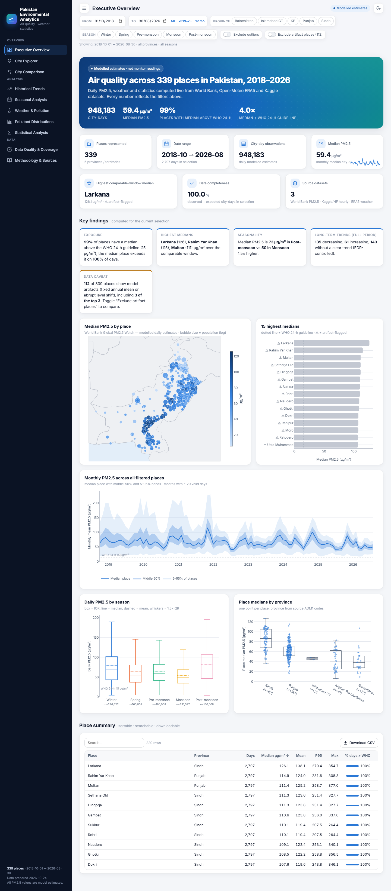
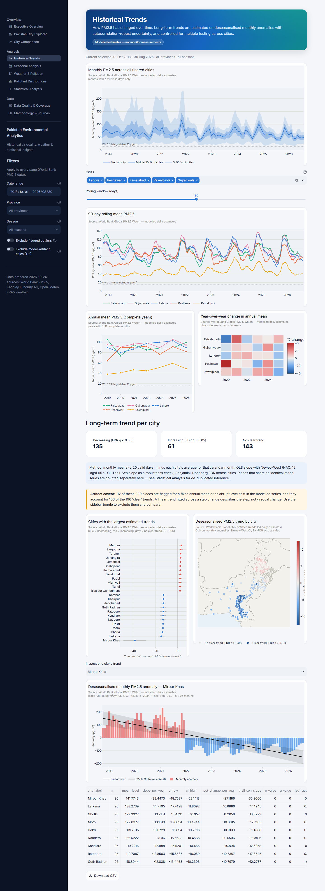
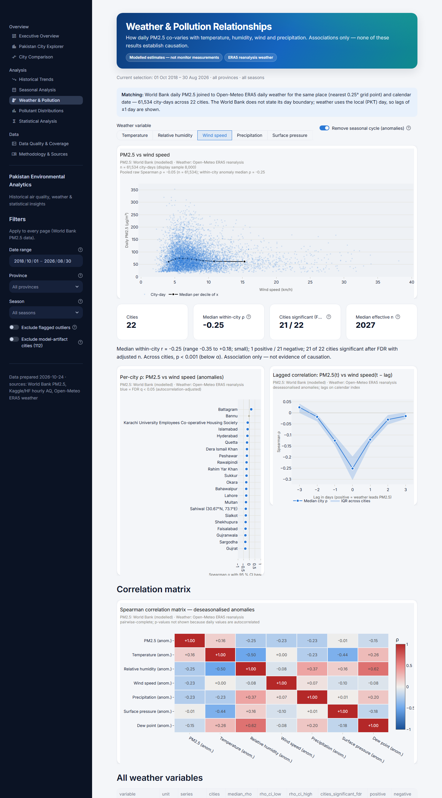
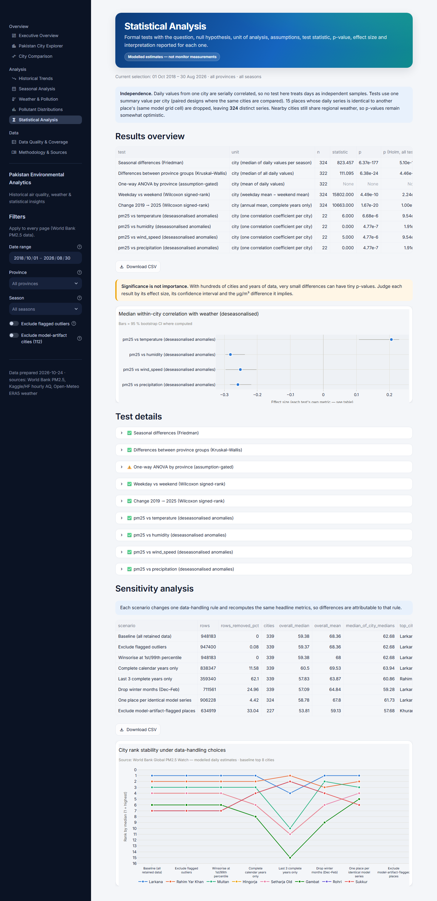
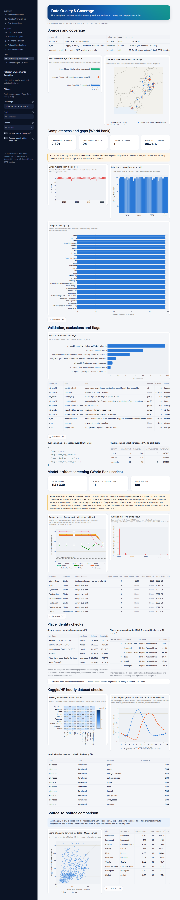
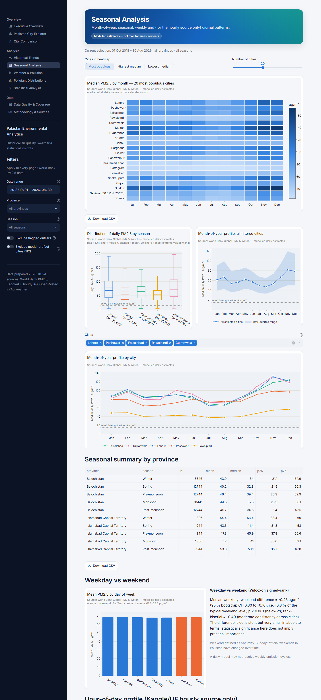
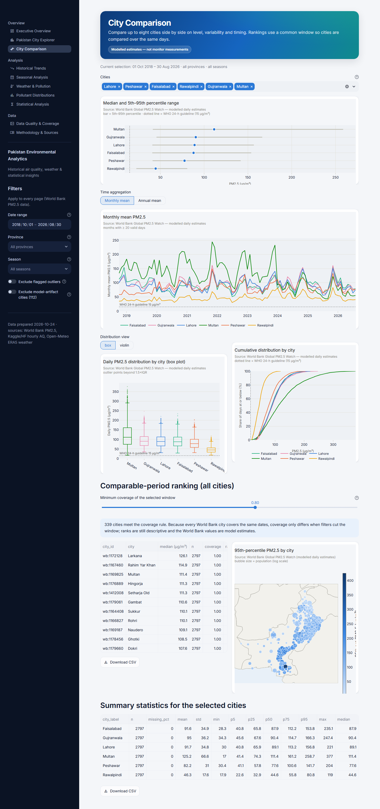

# Pakistan Environmental Analytics

**Historical air quality, weather & statistical insights for Pakistani cities**

A reproducible data-analytics project: a documented pipeline that turns three public datasets into
analysis-ready tables, a library of tested analysis and statistics functions, 40 Plotly chart functions, and a
10-page Streamlit dashboard. It runs **entirely from local files**: no API key, database, Docker or internet
connection is needed once the dependencies are installed.

> **Read this first.** Every PM2.5 value in this project is a **model estimate** (World Bank Global PM2.5
> Watch; a Kaggle/HF dataset that appears to be CAMS model output). None is a reading from a monitor. Weather
> is ERA5 reanalysis. Results describe the models' output and are associations, not causal effects.

[](https://pakistanenvironmentalanalytics.vercel.app)

**Live dashboard:** <https://pakistanenvironmentalanalytics.vercel.app> (static web version, deployed on Vercel)
**Source code:** <https://github.com/alirazach476/PakistanEnvironmentalAnalytics>



---

## Research questions

| Question | Where it is answered |
|---|---|
| Which cities have the highest long-term PM2.5? | Executive Overview, City Comparison (common-window ranking) |
| How do patterns change by month, year and season? | Seasonal Analysis, Historical Trends |
| Which cities improved or deteriorated? | Historical Trends (deseasonalised trends, FDR-controlled) |
| How are PM2.5 and PM10 distributed across cities? | Pollutant Distributions (World Bank daily; Kaggle/HF hourly for PM10 and gases) |
| How does pollution relate to temperature, humidity, wind and precipitation? | Weather & Pollution |
| How complete and reliable are the data? | Data Quality & Coverage |
| Which results are statistically meaningful? | Statistical Analysis (effect sizes, multiple-testing control) |
| How do results change with the period or the data-quality rules? | Sidebar filters everywhere; sensitivity analysis |

## Findings computed from the data

The numbers below are copied from [`reports/findings.md`](reports/findings.md), which
`python scripts/generate_reports.py` regenerates from the prepared data. Data prepared and report generated on
2026-10-24. If the data are re-prepared, the report is authoritative and this section should be refreshed.

1. **Coverage.** World Bank: 339 places, 1 Oct 2018 – 30 Aug 2026, 948,183 city-days. The last day of
   every month is missing for every place (94 dates), which is a systematic gap in the source files.
2. **Levels.** The median daily PM2.5 across all city-days is 59.4 µg/m³. 99 % of places have a median above
   the WHO 24-hour guideline (15 µg/m³).
3. **The headline ranking is dominated by model artifacts.** All of the 10 highest-median places (Larkana,
   Rahim Yar Khan, Multan, …) are flagged by the artifact screen. Eleven places have the *same annual mean
   (within 0.5 %) for 3–7 consecutive years*, and 106 show an abrupt level shift, most often in
   **January 2022 (88 places, mostly in Sindh)**. With flagged places excluded, the top three are
   Khurarianwala, Sargodha and Ladhewala Waraich.
4. **Seasonality is strong and consistent.** The median is highest post-monsoon (72.8 µg/m³) and lowest during
   the monsoon (49.8 µg/m³). Friedman test across 324 distinct series: Kendall's W = 0.64.
5. **The apparent decline depends on the artifacts.**
   - All places: 135 decreasing trends, 61 increasing and 143 with no clear trend. City-level change from
     2019 to 2025 is a median of −10.9 % (95 % CI −17.1 to −5.6 %).
   - Flagged places excluded: 30 decreasing, 60 increasing and 137 with no clear trend. The median change is
     −0.7 % (95 % CI −2.4 to +0.8 %), so there is **no clear overall change**.
6. **Weather associations are modest.** Within cities, after removing the seasonal cycle, the median
   Spearman ρ is −0.25 for wind speed, −0.26 for precipitation, −0.28 for humidity and +0.21 for
   temperature. For temperature and pressure the **sign flips** relative to the raw correlations, so their
   raw association is seasonal.
7. **Significant ≠ important.** Weekdays differ from weekends by a median of −0.23 µg/m³ (−0.3 % of the
   level). The result is p < 0.001, but the difference is negligible in practice.
8. **The two PM2.5 models disagree.** On 880 matched city-days, daily Pearson r between the Kaggle/HF and
   World Bank series ranges from −0.28 to +0.40 (median +0.05), and the ratio of medians from 0.44 to 1.43.

## Features

- **Pipeline:**
  - Streams the 1 GB World Bank regional CSV and keeps only Pakistan rows.
  - Normalises names, dates and units, validates schema and plausible ranges, and de-duplicates.
  - Logs every exclusion, flag and transformation, and records input SHA-256 hashes in a manifest.
  - Is idempotent: re-running it never accumulates rows.
- **Data-quality diagnostics:**
  - completeness and gap patterns
  - duplicate and range checks
  - robust outlier flags
  - ambiguous place names
  - places that share an identical model series
  - province-code consistency
  - fixed-annual-mean and level-shift artifact screening
  - an hourly timestamp-alignment diagnostic
  - source-to-source agreement
- **Statistics:**
  - Friedman, Kruskal–Wallis, assumption-gated ANOVA, Wilcoxon and Mann–Whitney tests, each with an
    effect size (Kendall's W, ε², η², rank-biserial) and bootstrap CIs.
  - Correlations with p-values adjusted for autocorrelation (effective sample size), with lagged and
    deseasonalised variants.
  - Trend slopes with Newey–West (HAC) intervals and Theil–Sen estimates.
  - Holm and Benjamini–Hochberg corrections; a sensitivity analysis over 8 data-handling scenarios.
- **Dashboard (10 pages):**
  - Global date, province, season, outlier and artifact filters.
  - KPI cards computed from the data, with an explained empty state for every chart.
  - CSV downloads of filtered data and summaries; caching for expensive computations.
  - Maps that render without a tile server, so they work offline.
- **Reports:** 16 CSV tables and a narrative `findings.md`, all regenerated by one command.

## Dashboard pages

| | Page | Highlights |
|---|---|---|
| 1 | Executive Overview | KPIs, computed key findings, bubble map, ranking, national monthly band, season and province distributions |
| 2 | Pakistan City Explorer | Daily series with configurable rolling window, year × month calendar, monthly profile, outliers, weather scatter |
| 3 | City Comparison | Median + 5–95 % dots, monthly/annual lines, box/violin, ECDF, common-window ranking with coverage rule, p95 map |
| 4 | Historical Trends | National band, rolling means, annual lines, YoY heatmap, trend forest, trend map, single-city trend with HAC band |
| 5 | Seasonal Analysis | Month × city heatmap, season boxes, month profiles, weekday test, hour-of-day profile (hourly source only) |
| 6 | Weather & Pollution | Scatter with binned medians, per-city ρ with CIs, lag correlation, correlation matrix (raw/anomaly) |
| 7 | Pollutant Distributions | Histogram (log option), WHO exceedance, violin, ECDF, percentiles, outliers, hourly PM10/NO₂/SO₂/CO/O₃/dust |
| 8 | Statistical Analysis | Every test with question, H₀, n, assumptions, statistic, p, effect size, interpretation; sensitivity |
| 9 | Data Quality & Coverage | Source coverage, gaps, exclusion log, artifact screen, identity checks, hourly diagnostics, source agreement |
| 10 | Methodology & Sources | Rendered docs and the pipeline manifest |

<details><summary>More screenshots (captured from the running app)</summary>

| | |
|---|---|
|  |  |
|  |  |
|  |  |

</details>

## Architecture

```
raw files ──► src/data (load → clean/validate → transform) ──► data/processed/*.parquet + log + manifest
                                                                   │
          src/analysis (descriptive, trends, seasonality, correlations, statistical_tests,
                        data_quality, sensitivity)  ◄──────────────┤
                                                                   │
          src/visualization (themes, charts, maps) ──► pages/ (Streamlit) · notebooks/ · scripts/generate_reports.py
```

```
pakistan-environmental-analytics/
├── app.py                         # Streamlit entry point (st.navigation + global filters)
├── pages/                         # 10 dashboard pages
├── src/
│   ├── data/        load.py clean.py validate.py transform.py pipeline.py
│   ├── analysis/    descriptive.py trends.py seasonality.py correlations.py statistical_tests.py
│   │                data_quality.py sensitivity.py
│   ├── visualization/ charts.py maps.py themes.py
│   ├── ui/          common.py (filters, caching, KPI cards) cached.py
│   └── utils/       config.py (all rules & thresholds) paths.py
├── scripts/
│   ├── extract_worldbank_pakistan.py   # stream Pakistan rows out of the WB regional zip
│   ├── fetch_openmeteo_weather.py      # one-time ERA5 download (never called by the app)
│   ├── prepare_data.py                 # rebuild data/processed
│   ├── generate_reports.py             # rebuild reports/
│   ├── build_notebooks.py              # (re)create notebooks
│   ├── capture_screenshots.py          # screenshots of the running app
│   └── project_metrics.py              # docs/project_metrics.md
├── data/  raw/ processed/ sample/
├── notebooks/  01_dataset_audit … 05_city_comparisons (executed)
├── reports/    16 CSV tables + findings.md
├── tests/      unit, integration and headless page tests
└── docs/       data_sources.md data_dictionary.md methodology.md project_metrics.md screenshots/
```

## Data sources and licences

| Source | Values | Resolution | Coverage in this project | Licence |
|---|---|---|---|---|
| [World Bank Global PM2.5 Watch](https://datacatalog.worldbank.org/search/dataset/0067162/daily-city-level-air-pollution-pm2-5-estimates-2018-2026) | PM2.5 (modelled) | daily | 339 places, Oct 2018 – Aug 2026 | CC BY-SA 4.0 |
| [Kaggle/HF Pakistan AQ & Weather](https://huggingface.co/datasets/jason1966/ahsanneural_pakistan-air-quality-and-weather-10-cities) | PM2.5, PM10, CO, NO₂, SO₂, O₃, dust, weather (modelled) | hourly | 10 cities, 6 Nov 2025 – 4 Feb 2026 | **unknown** |
| [Open-Meteo ERA5](https://open-meteo.com/en/docs/historical-weather-api) | temperature, humidity, wind, precipitation, pressure, dew point | daily | 22 places, Oct 2018 – Aug 2026 | CC BY 4.0 |

See [docs/data_sources.md](docs/data_sources.md) for provenance and manual-download placement, and
[docs/data_dictionary.md](docs/data_dictionary.md) for every field.

## Installation

Requires Python 3.12 (tested with 3.12.10 on Windows 11).

```bash
python -m venv .venv
# Windows: .venv\Scripts\activate     macOS/Linux: source .venv/bin/activate
pip install -r requirements.txt          # dashboard + pipeline
pip install -r requirements-dev.txt      # + tests, notebooks, screenshots
```

## Preparing the data

The repository ships the prepared tables in `data/processed/`, so the dashboard runs immediately. To rebuild
from scratch:

```bash
# 1. World Bank archive (75.5 MB) → data/raw/worldbank_pm25/
curl -L -o data/raw/worldbank_pm25/PM25_Middle_East_North_Africa_Afghanistan_Pakistan.zip \
  https://datacatalogfiles.worldbank.org/ddh-published/0067162/DR0096340/PM25_Middle_East_North_Africa_Afghanistan_Pakistan.zip
# 2. Optional hourly dataset → data/raw/hf_pakistan_aq/
curl -L -o data/raw/hf_pakistan_aq/pakistan_air_quality_final_clean.csv \
  https://huggingface.co/datasets/jason1966/ahsanneural_pakistan-air-quality-and-weather-10-cities/resolve/main/pakistan_air_quality_final_clean.csv
# 3. Extract Pakistan rows and build every processed table
python scripts/prepare_data.py --extract
# 4. Optional: re-fetch ERA5 weather (≈ 5 min, skips cities already downloaded), then rebuild
python scripts/fetch_openmeteo_weather.py
python scripts/prepare_data.py
```

## Running

```bash
streamlit run app.py                      # dashboard → http://localhost:8501
python -m pytest                          # all tests
python scripts/generate_reports.py        # regenerate reports/
python -m jupyter lab notebooks/          # open the notebooks
python -m jupyter nbconvert --to notebook --execute --inplace notebooks/*.ipynb   # re-execute them
python scripts/capture_screenshots.py --port 8501   # with the app running
```

## Testing

`tests/` contains:
- **Unit tests on synthetic fixtures.** These cover loading, schema and unit validation, date parsing and
  time zones, city normalisation, duplicate handling, missing data, aggregation rules, descriptive
  statistics, correlations, trends, statistical test outputs, artifact diagnostics, and empty or missing
  inputs.
- **Integration tests on the real prepared data.** These check schemas, source separation, the absence of
  synthetic rows, key uniqueness and pipeline idempotency.
- **Headless page tests.** Every dashboard page is run through Streamlit's `AppTest`, including a very narrow
  filter that exercises the empty states.

Synthetic fixtures exist only in memory and carry `value_type="synthetic"`. `real_only()` removes such rows
before any real-data computation, and a test asserts that no processed table contains them. The latest
measured counts are in [docs/project_metrics.md](docs/project_metrics.md).

## Statistical methodology (summary)

- **Unit of analysis.** The unit is the city, never the day. Repeated daily values are serially correlated,
  so tests use one summary per city, with paired designs across seasons or years. Places that share an
  identical model series are reduced to one representative.
- **Trends.** Slopes are fitted to deseasonalised monthly anomalies using OLS with Newey–West (HAC) 95 % CIs,
  with Theil–Sen as a robustness check and Benjamini–Hochberg FDR across cities.
- **Correlations.** Spearman ρ is computed within each city on raw values and on anomalies. p-values and CIs
  use an effective sample size for lag-1 autocorrelation, and lags of ±3 days are shown.
- **Assumption-gated ANOVA.** ANOVA is reported only when Shapiro–Wilk and Levene do not reject. Otherwise the
  dashboard explains why and points to Kruskal–Wallis.
- **Reporting.** Every result shows n, an effect size with its CI and an interpretation generated from the
  numbers. Holm and FDR corrections are applied, and interpretations explicitly separate significance from
  importance.

Full details: [docs/methodology.md](docs/methodology.md).

## Units, definitions, modelled vs measured

- PM2.5, PM10 and gases are reported in µg/m³. The World Bank catalogue does not state units; µg/m³ is assumed
  and labelled as an assumption.
- Values are never converted to AQI. WHO 2021 guidelines (24-hour 15 µg/m³, annual 5 µg/m³) appear only as
  reference lines.
- Temperature is in °C, humidity in %, wind in km/h, precipitation in mm and pressure in hPa.
- Every row carries a `source_id` and a `value_type` (`measured` / `modelled` / `synthetic`). All real data in
  this project are `modelled`.

## Data-quality limitations

- There is no ground-truth monitor data.
- The World Bank model fixes annual levels and shows abrupt shifts for many places (112 of 339 flagged).
  Rankings and trends for those places describe model behaviour.
- The Kaggle/HF data have an unknown licence and undocumented provenance, and cover a single winter. Their
  pollutant and weather columns appear to be about 6 hours out of step, and Islamabad and Rawalpindi share
  identical series for most variables.
- ERA5 weather is available for 22 places only, on a 0.25° grid.
- Province labels are derived from source ADM1 codes, without a boundary overlay.
- The World Bank day boundary is undocumented.

## Web dashboard (Vercel)

`web/` is a static single-page version of the dashboard: HTML/CSS and vanilla JS with Plotly.js served from the
site itself, plus light/dark themes and shareable filter URLs. It ships the same data and precomputed analysis:
- `scripts/export_web_data.py` writes `web/data/`. Daily PM2.5 for every place is packed into a ~1.9 MB binary
  file.
- Filtered statistics are computed in the browser using the same aggregation rules as the Python code.
- Tests, trends, correlations and sensitivity results are precomputed by the tested Python functions on the
  full period.

```bash
python scripts/export_web_data.py                 # rebuild web/data from data/processed
python -m http.server 8765 --directory web        # preview at http://127.0.0.1:8765
python scripts/check_web.py --url http://127.0.0.1:8765/   # load every route, report JS errors, screenshots
cd web && vercel deploy --prod                     # project: pakistanenvironmentalanalytics
```

Deployed 2026-10-25 to <https://pakistanenvironmentalanalytics.vercel.app>. Every route was verified on the live
URL with no JavaScript errors.

## Deploying the Streamlit app

The Streamlit app itself has **not** been deployed; the public link above is the static web version. To host the
Streamlit app, a suitable free option is **Streamlit Community Cloud**:

1. Push the repository to GitHub, including `data/processed/` (about 11 MB). The 76 MB World Bank zip is
   git-ignored and is not needed at runtime.
2. On share.streamlit.io, choose **New app**, select the repo and branch, and set the main file to `app.py`.
   If a Python-version option is offered, pick 3.12, the version this project was tested with.
   `requirements.txt` is installed automatically.
3. No secrets are required.

Current platform constraints (checked 2026-10-24 on the
[Streamlit docs](https://docs.streamlit.io/deploy/streamlit-community-cloud/manage-your-app)):
- **Memory:** the docs list about 690 MB minimum and 2.7 GB maximum, "as of February 2024", and say limits may
  change without notice. A 2026 third-party guide reports about 1 GB. Measured locally, loading every
  processed table takes about 430 MB of process memory.
- **Sleep:** apps sleep after 12 hours without traffic.
- **Licensing:** the Kaggle/HF file has no stated licence. For a public deployment, consider removing
  `data/raw/hf_pakistan_aq/` and `data/processed/hf_*.parquet`. The app then shows explained empty states for
  the hourly views.

## Future improvements

- Add measured data, such as Pakistan EPA or Punjab EPD monitors, or OpenAQ, as a separate `measured` source,
  and evaluate both models against it.
- Join provinces with an official boundary file, and investigate the January 2022 shift with the data provider.
- Add formal change-point detection (e.g. PELT) with multiple-testing control, and segment-wise trends.
- Extend ERA5 coverage to all places, and add boundary-layer height (available hourly from ERA5).
- Use mixed-effects or spatial models that account for dependence between neighbouring cities.
